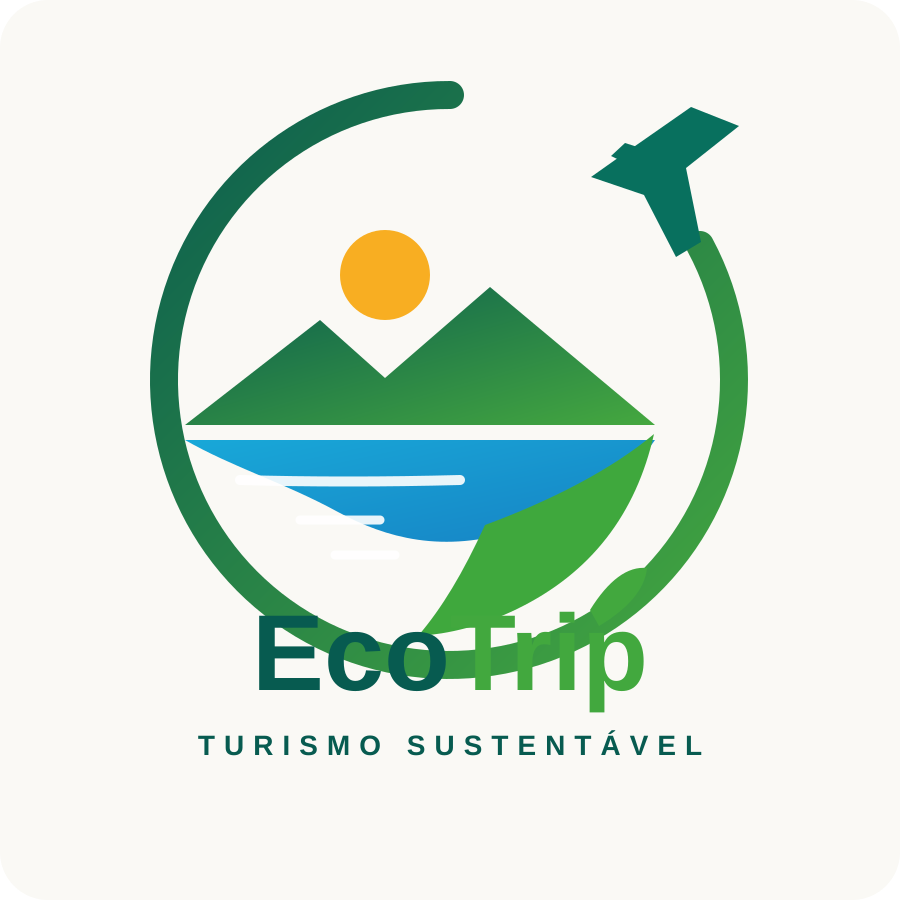

# 🌱 EcoTrip — Turismo Sustentável

<p align="center">
  
</p>

<p align="center"><strong>Projeto Integrador — Desenvolvimento Front-end para Web</strong></p>

Projeto acadêmico com o tema **EcoTrip — Turismo Sustentável**, desenvolvido progressivamente durante as aulas. Cada conteúdo fica em sua própria pasta, mostrando a evolução do projeto.

## 📚 Conteúdos desenvolvidos

### Fundamentos do Desenvolvimento Web
Organização inicial, Git/GitHub, README, `.gitignore` e estrutura da página.

### Estrutura HTML5 e Conceitos Web
Metadados, títulos, parágrafos, listas, tabela, links, imagens e organização de pastas.

### HTML5 Semântico e Formulários
Elementos semânticos, formulários, validação nativa e acessibilidade.

### HTML5 Multimídia
Vídeo, formatos alternativos, poster, legendas WebVTT e `canPlayType()`.

### HTML5 Canvas e SVG
Gráficos vetoriais, Canvas, `clearRect()`, `requestAnimationFrame()` e acessibilidade.

### CSS3: Sintaxe, Seletores e Estilização
CSS externo, reset, variáveis, seletores, especificidade, box model, tipografia, links, tabelas e formulários.

### CSS3: Pseudo-classes, Flexbox e Grid
Pseudo-classes, Flexbox, flex-grow/flex-shrink/flex-basis, Grid, áreas nomeadas e grade responsiva.

### CSS3: Menus e Navegação
Navbar com Flexbox, estado ativo, dropdown, `:hover`, `:focus-within`, `position: sticky` e `z-index`.

### JavaScript: Lógica e Análise de Dados
Array de objetos com destinos do EcoTrip, conversão e validação de entrada, condicionais, `switch`, laços, resumo de vagas, consulta por nome e relatório com `console.table()`.

## 🎨 Identidade visual

A identidade do EcoTrip representa a união entre **viagem e sustentabilidade**, com elementos visuais ligados à natureza, água, montanhas, folhas, sol e avião. A logo está em SVG para manter a qualidade vetorial.

## 📁 Estrutura do projeto

```text
projeto_integrador_front-end/
├── assets/
│   └── logo-ecotrip.svg
├── Fundamentos do Desenvolvimento Web/
├── Estrutura HTML5 e Conceitos Web/
├── HTML5 Semântico e Formulários/
├── HTML5 Multimídia/
├── HTML5 Canvas e SVG/
├── CSS3 Sintaxe Seletores e Estilização/
├── CSS3 Pseudo-classes Flexbox e Grid/
├── CSS3 Menus e Navegação/
├── JavaScript — Lógica e Análise de Dados/
├── Meu primeiro código HTML/
├── README.md
└── .gitignore
```

## 🛠️ Tecnologias

HTML5 · CSS3 · JavaScript · SVG · Canvas API · Git · GitHub

## 🌱 Sobre o EcoTrip

O EcoTrip é uma proposta de turismo sustentável que apresenta destinos e incentiva escolhas mais conscientes, valorizando a natureza e as comunidades locais.

**EcoTrip — Viaje com propósito. 🌱✈️**